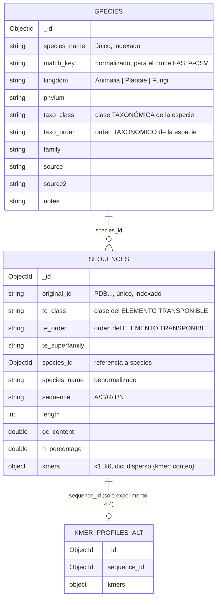

# Modelo de datos — PanTEon en MongoDB

## Diagrama

## Colecciones

### `species` (~2790 documentos)

Una especie por documento, poblada desde el CSV. Incluye la jerarquía taxonómica
completa (Reino → Filo → Clase → Orden → Familia) y la procedencia de su biblioteca
de TEs (`source`, `source2`, `notes`).

Los campos taxonómicos se llaman `taxo_class` / `taxo_order` (no `class`/`order`)
para no confundirlos con la clasificación del elemento transponible, que vive en
`sequences.te_class` / `sequences.te_order` — el enunciado advierte explícitamente
que son conceptos distintos que comparten nombre en el CSV y el FASTA.

`match_key` es el nombre de especie normalizado (sin puntos, en minúsculas) usado
solo para el cruce FASTA↔CSV durante la carga; no es un campo "de negocio".

### `sequences` (~239,946 documentos)

Un elemento transponible por documento. Contiene:
- Identidad: `original_id` (el `PDB...` del FASTA).
- Clasificación del TE: `te_class`, `te_order`, `te_superfamily`.
- Vínculo a la especie: `species_id` (referencia) + `species_name` (copia denormalizada).
- La secuencia de nucleótidos (`sequence`, siempre en mayúsculas).
- Atributos derivados: `length`, `gc_content`, `n_percentage`.
- Perfiles de k-mers para k=1..6, embebidos en `kmers.k1` … `kmers.k6`.

### `kmer_profiles_alt`

Colección exclusiva para el experimento de la sección 4.4 (comparar "embebido" vs.
"colección aparte"). No forma parte del modelo de producción usado para responder
las 15 consultas obligatorias.

## Decisiones de diseño y alternativas consideradas

**¿Qué entidades identifican y en qué colecciones quedan?**
Dos entidades naturales: la *especie* (con su taxonomía) y el *elemento transponible*
(con su secuencia y clasificación). Se evaluó fusionarlas en una sola colección
(una especie con un arreglo de TEs embebidos), pero se descartó: un documento de
MongoDB tiene un límite de 16 MB y algunas especies tienen >1600 secuencias con
hasta ~5460 valores de k-mers cada una — fácilmente se superaría el límite para las
especies más grandes (p. ej. *Malus domestica*, 1627 TEs).

**¿Qué se embebe y qué se referencia?**
- `sequences` **referencia** a `species` (`species_id`) en vez de embeber toda la
  taxonomía en cada secuencia: la taxonomía se repetiría ~86 veces en promedio por
  especie (239,946 / 2790), inflando el almacenamiento sin necesidad, y un cambio en
  la taxonomía de una especie requeriría actualizar todas sus secuencias.
- Se **denormaliza** `species_name` (un solo campo, no toda la taxonomía) dentro de
  `sequences`, porque la mayoría de consultas de negocio (listar TEs, generar
  bibliotecas FASTA) necesitan el nombre de la especie sin pagar un `$lookup`
  completo; es un campo pequeño y estable (no cambia).
- Los **k-mers se embeben** en el documento de la secuencia (no en una colección
  aparte) como opción principal: siempre se consultan junto con su secuencia dueña
  y nunca se comparten entre secuencias, por lo que no hay razón de negocio para
  separarlos. La alternativa (colección aparte) se implementa solo para el
  experimento comparativo de la sección 4.4.

**¿Cómo se representa la jerarquía Clase/Orden/Superfamilia del TE y la jerarquía
taxonómica de la especie?**
Como campos planos con nombres explícitos y sin ambigüedad (`te_class/te_order/
te_superfamily` vs. `kingdom/phylum/taxo_class/taxo_order/family`), en vez de un
subdocumento anidado genérico `classification: {class, order, ...}` que podría
usarse por error para cualquiera de las dos jerarquías. Se prefirió explicitud sobre
brevedad justamente por la advertencia del enunciado sobre el riesgo de confundirlas.

**¿Cómo se guardan los k-mers?**
- **Conteos, no frecuencias**: una frecuencia se puede derivar de un conteo
  (`conteo / (length - k + 1)`), pero no al revés sin guardar un dato adicional. El
  conteo es la representación más informativa y comprimible.
- **Diccionario disperso, no arreglo denso**: para k=6 hay 4096 k-mers posibles;
  una secuencia típica de ~4000 nt solo produce ~4000 ocurrencias, así que un arreglo
  denso de 4096 posiciones estaría mayormente en cero. Un objeto BSON con solo las
  llaves observadas (p. ej. 1253 de 4096 para k=6 en el ejemplo probado) ahorra
  espacio y evita procesar ceros en las agregaciones.
- Un documento por k (`k1`...`k6`) dentro de un único subdocumento `kmers`, en vez
  de 6 colecciones separadas o 6 campos de nivel superior: agrupa lógicamente toda
  la información derivada de k-mers de una secuencia y permite proyectar solo el
  `k` que se necesite (consulta 15) sin traer los demás.

**¿Qué se hace con valores faltantes, nombres inconsistentes y registros que no
cruzan?** Ver `docs/data_quality_notes.md` para el detalle completo. En resumen:
placeholders de texto como `"No trobat"` se normalizan a `null`; las 4 especies que
no cruzaban por un punto en `subsp./sp.` se resuelven normalizando la llave de
cruce (`match_key`); las secuencias cuya especie no exista en `species` tras la
normalización se omiten de la carga y se reportan (no se insertan con
`species_id` nulo, porque el modelo exige la referencia).

**Índices creados y qué consulta justifica cada uno**
| Índice | Colección | Consulta que soporta |
|---|---|---|
| `species_name` (único) | species | Join por nombre, prevenir duplicados |
| `match_key` | species | Cruce FASTA↔CSV durante la carga |
| `kingdom` | species | Agrupar/filtrar por reino (consultas 3, 6, 7, 13) |
| `original_id` (único) | sequences | Búsqueda por identificador (consulta 8), unicidad |
| `species_id` | sequences | `$lookup` con species (consulta 12), conteos por especie (2, 4) |
| `(te_class, te_order, te_superfamily)` compuesto | sequences | Conteos por clasificación (consulta 1), filtros de biblioteca (9, 10, 11) |

**Validación de esquema (`$jsonSchema`)**
Se aplica a `species` y `sequences` (los datos "núcleo" del proyecto): campos
obligatorios, tipos, y en `sequences.sequence` un patrón `^[ACGTN]+$` que impide
insertar secuencias con caracteres fuera del alfabeto esperado. No se aplica a
`kmer_profiles_alt` por ser una colección auxiliar de experimentación, no de
producción.
